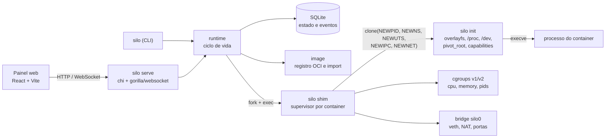

<p align="center">
  
</p>

<h1 align="center">Silo<br><sub><sup><sup><sub>Copyright (©) 2026 Clara Portes</sub></sup></sup></sub></h1>

<p align="center">
  Runtime de containers escrito em Go que usa direto os recursos do kernel Linux: namespaces para isolar processos, rede e sistema de arquivos, cgroups para limitar CPU, memória e processos, e pivot_root com overlayfs para dar a cada container a sua própria raiz.
</p>

<p align="center">
  Versão 1.1.0. Go 1.24, React 19 + Vite, SQLite. Licença MIT.
</p>

---

O Silo não depende de Docker, containerd nem runc. Um único binário, `silo`, faz o papel de linha de comando, supervisor de containers, processo inicial dentro do container e servidor da API com o painel web embutido.

Documentação completa em PDF:

- [`Manual-Silo.pdf`](Manual-Silo.pdf): instalação no Linux e no Windows (WSL2), cada comando da CLI, como o isolamento e os limites funcionam por dentro, rede, imagens, cada tela do painel, API, configuração, como estender o projeto, testes e solução de problemas. Cópia em [`docs/`](docs/Manual-Silo.pdf).
- [`Banco-de-Dados-Silo.pdf`](Banco-de-Dados-Silo.pdf): diagrama de relacionamentos, todas as tabelas com campos, tipos, chaves e índices, a máquina de estados dos containers, as migrações, os arquivos em disco e o backup. Cópia em [`docs/`](docs/Banco-de-Dados-Silo.pdf).

<p align="center">
  
</p>

## O que o Silo faz

- Cada container nasce em namespaces próprios de PID, montagem, UTS, IPC, rede e cgroup. O processo principal é o PID 1 do container e não enxerga nada do host.
- A imagem vira a camada de baixo de um overlayfs e o container escreve só na sua camada de cima. Depois, o `pivot_root` troca a raiz e a antiga é desmontada. Quando o `pivot_root` não é possível, o Silo usa `chroot`.
- Os limites usam cgroups: CPU em núcleos (`--cpus 0.5`), peso relativo, memória sem swap (`-m 256m`) e número máximo de processos (`--pids-limit`). Funciona em cgroups v2 e v1; a versão é detectada sozinha.
- Rede em três modos. `bridge` dá ao container um IP próprio na bridge `silo0`, com par veth, rota padrão e NAT para a internet. `none` deixa só a loopback. `host` usa a rede do servidor. Portas são publicadas com `-p 8080:80`, em TCP e UDP.
- Baixa imagens OCI e Docker de qualquer registro compatível (Docker Hub, GHCR, registros privados), escolhe a arquitetura do host, confere o digest de cada camada e aplica os whiteouts. Também importa um rootfs em `.tar` ou `.tar.gz`.
- Ciclo de vida completo: `run`, `create`, `start`, `stop` (SIGTERM e depois SIGKILL), `restart`, `kill`, `rm`, `exec`, `logs -f`, `stats`, `top`, `inspect`, `events` e `prune`, com políticas de reinício `on-failure` e `always`.
- Por padrão, as capabilities perigosas são removidas, `/proc/kcore`, `/proc/keys` e similares ficam mascarados e `/proc/sys` fica somente leitura. A raiz somente leitura e a troca de usuário dentro do container são opcionais.
- API REST com WebSocket para saída e eventos em tempo real, especificação OpenAPI, métricas no formato Prometheus e um painel web que mostra e controla tudo.

## Ver rodando

O Silo usa recursos do kernel Linux e precisa de root. No Windows, use o WSL2 (instruções em [Instalação](#instalação)).

```bash
git clone https://github.com/Violet-pixel/Container-Runtime-Engine.git
cd Container-Runtime-Engine
./scripts/install.sh

sudo silo pull alpine:3.20
sudo silo run --rm alpine:3.20 sh -c 'hostname; ps; ip addr'
sudo silo serve          # painel em http://127.0.0.1:7070
```

O `ps` mostra só os processos do container, com o `sh` como PID 1, e o `ip addr` mostra uma `eth0` com IP na faixa 10.88.0.0/16.

<p align="center">
  
</p>

## Instalação

### Requisitos

| Item | Versão mínima | Para quê |
|---|---|---|
| Linux | kernel 4.18 (5.x recomendado) | Namespaces, overlayfs e cgroups |
| Root | | Criar namespaces, montar, mexer em cgroups e em interfaces de rede |
| Go | 1.24 | Compilar o binário |
| gcc ou clang | | O driver do SQLite usa cgo |
| iproute2, util-linux, iptables | | `ip`, `nsenter` e NAT. Sem iptables, os containers só falam com o host |
| Node.js | 20 (22 recomendado) | Só para recompilar a interface; o repositório já traz a interface compilada |

### Linux (Ubuntu, Debian, Fedora, Arch)

1. Instale as dependências. No Ubuntu ou Debian:
   ```bash
   sudo apt install -y git golang build-essential iproute2 util-linux iptables
   ```
   No Fedora: `sudo dnf install -y git golang gcc iproute util-linux iptables`.
2. Confira se o Go é 1.24 ou mais novo com `go version`.
3. Clone o repositório e entre na pasta:
   ```bash
   git clone https://github.com/Violet-pixel/Container-Runtime-Engine.git
   cd Container-Runtime-Engine
   ```
4. Rode `./scripts/install.sh`. O script compila a interface (se houver Node.js), compila o binário e instala em `/usr/local/bin/silo`.
5. Teste com `sudo silo info`. A saída mostra a versão dos cgroups e o tipo de armazenamento detectados.

Para instalar também o serviço do systemd com a API e o painel, rode `WITH_SERVICE=1 ./scripts/install.sh`. O serviço lê `/etc/silo/silo.env` e reiniciá-lo não derruba os containers, porque cada um tem o seu próprio supervisor.

### Windows

1. No PowerShell como administrador, rode `wsl --install -d Ubuntu` e reinicie se o Windows pedir.
2. Abra o Ubuntu pelo menu Iniciar e crie o usuário do Linux.
3. Siga os passos do Linux dentro do Ubuntu. O kernel do WSL2 já tem namespaces, cgroups e overlayfs.
4. O painel abre no navegador do Windows em `http://localhost:7070`.

## Uso

### Primeiros passos

```bash
sudo silo pull alpine:3.20
sudo silo run --rm alpine:3.20 sh -c 'hostname; ps; ip addr'
sudo silo run -d --name web -p 8080:80 -m 128m --cpus 0.5 nginx:alpine
curl http://localhost:8080
sudo silo stats web
sudo silo exec -it web sh
sudo silo logs -f web
sudo silo stop web && sudo silo rm web
```

Sem acesso a registros, gere um rootfs com os binários do próprio host e importe:

```bash
./scripts/mkrootfs.sh base.tar.gz
sudo silo import base.tar.gz base:1 /bin/sh
sudo silo run --rm base:1 sh -c 'echo olá de $(hostname)'
```

### Painel web e API

```bash
sudo silo serve                                              # http://127.0.0.1:7070
sudo silo serve --addr 0.0.0.0:7070 --token um-token-longo   # fora do localhost o token é obrigatório
```

| Endereço | O que é |
|---|---|
| http://127.0.0.1:7070 | Painel: visão geral, containers, imagens e eventos |
| http://127.0.0.1:7070/api/v1 | API REST |
| http://127.0.0.1:7070/api/openapi.yaml | Especificação OpenAPI |
| http://127.0.0.1:7070/api/v1/metrics | Métricas no formato Prometheus |
| http://127.0.0.1:7070/healthz | Saúde do servidor |

<p align="center">
  
  
</p>

### Linha de comando

Todos os comandos precisam de root. Um container pode ser indicado pelo nome, pelo ID ou por um prefixo do ID com pelo menos 3 caracteres.

| Comando | O que faz |
|---|---|
| `silo run [opções] IMAGEM [CMD...]` | Cria e inicia. Sem `-d`, fica ligado ao terminal e repassa o código de saída |
| `silo create` / `silo start [-a]` | Cria sem iniciar e inicia depois |
| `silo stop [-t s]` / `silo restart` / `silo kill [-s SINAL]` | Para com SIGTERM e SIGKILL após o tempo, reinicia ou envia um sinal |
| `silo rm [-f]` / `silo prune` | Remove um container ou todos os parados |
| `silo ps [-a] [-q] [--json]` | Lista containers |
| `silo exec [-e] [-w] [-u] CONTAINER CMD...` | Executa um comando nos namespaces e no cgroup do container |
| `silo logs [-f] [-n N]` | Mostra a saída, opcionalmente em tempo real |
| `silo stats [--no-stream]` / `silo top` | Uso de recursos e processos |
| `silo inspect` | Tudo sobre um container ou imagem em JSON, inclusive caminhos e namespaces |
| `silo pull` / `silo import` / `silo images` / `silo rmi` | Gerenciamento de imagens |
| `silo events [-f]` / `silo info` / `silo serve` | Eventos, informações do host e API com painel |

Opções de `run` e `create` (vêm antes da imagem; o que vem depois da imagem é o comando):

| Opção | Exemplo | Efeito |
|---|---|---|
| `--name` | `--name api` | Nome do container |
| `-m` | `-m 256m` | Limite de memória sem swap |
| `--cpus` | `--cpus 1.5` | Limite de CPU em núcleos |
| `--cpu-weight` | `--cpu-weight 500` | Peso relativo de CPU (1 a 10000) |
| `--pids-limit` | `--pids-limit 64` | Máximo de processos |
| `-p` | `-p 127.0.0.1:8080:80/tcp` | Publica uma porta (repetível) |
| `-v` | `-v /srv/dados:/dados:ro` | Monta uma pasta do host (repetível) |
| `-e` | `-e MODO=producao` | Variável de ambiente (repetível) |
| `--network` | `--network none` | `bridge`, `host` ou `none` |
| `--restart` | `--restart on-failure:3` | `no`, `on-failure[:máx]` ou `always` |
| `--read-only` | | Raiz somente leitura |
| `-u`, `-w`, `--hostname`, `--entrypoint`, `--dns` | `-u 1000:1000` | Usuário, diretório, hostname, entrypoint e DNS |
| `--rm` | | Remove ao terminar |
| `--privileged` | | Mantém todas as capabilities |

### Configuração

Tudo é configurado por variáveis de ambiente. Com `sudo`, use `sudo -E` ou `sudo VAR=valor silo ...`. Um modelo está em [`deploy/silo.env.example`](deploy/silo.env.example).

| Variável | Padrão | Uso |
|---|---|---|
| `SILO_ROOT` | `/var/lib/silo` | Banco, imagens, containers e logs |
| `SILO_ADDR` | `127.0.0.1:7070` | Endereço do `silo serve` |
| `SILO_TOKEN` | vazio | Token exigido pela API |
| `SILO_BRIDGE` | `silo0` | Nome da bridge |
| `SILO_BRIDGE_CIDR` | `10.88.0.1/16` | Gateway e sub-rede dos containers |
| `SILO_STORAGE` | `auto` | `overlay`, `copy` ou `auto` (testa o overlayfs) |
| `SILO_STOP_TIMEOUT` | `10` | Segundos entre SIGTERM e SIGKILL |
| `SILO_EVENTS_RETAIN` | `5000` | Quantos eventos guardar |
| `SILO_REGISTRY_USER` / `SILO_REGISTRY_PASSWORD` | vazio | Credenciais de registro privado |
| `SILO_INSECURE_REGISTRIES` | vazio | Registros sem HTTPS, separados por vírgula |
| `SILO_CORS_ORIGIN` | vazio | Origem liberada para uma interface hospedada fora |

<p align="center">
  
</p>

## Por dentro



| Parte | Pasta | Responsabilidade |
|---|---|---|
| CLI | `cmd/silo` | Todos os comandos, inclusive `serve`, e os pontos de entrada internos `shim` e `init` |
| Runtime | `internal/runtime` | Criar, iniciar, parar, supervisionar, executar comandos, saída, estatísticas e processos |
| Init | `internal/runtime/init.go` | Código que roda dentro dos namespaces antes do `execve`: montagens, `pivot_root`, hostname, capabilities e usuário |
| Cgroups | `internal/cgroups` | Limites e estatísticas em cgroups v2 e v1 com a mesma interface |
| Rede | `internal/network` | Bridge, veth, NAT, IPs, DNS e o encaminhamento de portas TCP e UDP |
| Imagens | `internal/image` | Cliente de registro OCI, autenticação por token, camadas, whiteouts e importação |
| Banco | `internal/store` | SQLite com migrações, containers, imagens, portas e eventos |
| API | `internal/api` | Rotas REST, WebSocket, autenticação por token, OpenAPI e métricas |
| Interface | `web/` | Painel em React + TypeScript, compilado para dentro do binário |

### Como um container sobe

1. `silo run` grava o container no banco e, no modo `-d`, inicia um `silo shim` em segundo plano, numa sessão própria.
2. O shim cria o cgroup com os limites e chama o próprio binário como `silo init` com `clone()` em namespaces novos. O init fica parado esperando um sinal num pipe.
3. Com o PID do init, o shim coloca o processo no cgroup, cria o par veth, move uma ponta para o namespace de rede do container e configura IP, rota e loopback.
4. O shim libera o init, que monta o overlayfs, `/proc`, `/sys`, `/dev`, os volumes e os arquivos de `/etc`, faz o `pivot_root`, define o hostname, remove capabilities e executa o comando da imagem.
5. Se o `execve` falhar, o erro volta pelo pipe e aparece na CLI e no painel. Se der certo, o shim abre as portas publicadas e espera o processo terminar para registrar o código de saída, aplicar a política de reinício e limpar rede e cgroup.

O banco de dados (tabelas, estados, concorrência entre processos) está descrito no [`Banco-de-Dados-Silo.pdf`](Banco-de-Dados-Silo.pdf).

## Referência

### API

Todas as rotas ficam em `/api/v1`. Com `--token`, envie `Authorization: Bearer TOKEN`; nos WebSockets, use `?token=TOKEN`. Os erros têm sempre o formato `{"error": {"code": "...", "message": "..."}}`.

| Método e rota | O que faz |
|---|---|
| `GET /info` | Kernel, versão dos cgroups, armazenamento, CPUs, memória e contadores |
| `GET /containers`, `POST /containers` | Lista e cria (com `start` e `pull` opcionais) |
| `GET /containers/{id}`, `DELETE /containers/{id}?force=true` | Inspeciona e remove (ID, prefixo do ID ou nome) |
| `POST /containers/{id}/start\|stop\|restart\|kill` | Ciclo de vida |
| `POST /containers/{id}/exec` | Executa um comando curto e devolve a saída |
| `GET /containers/{id}/logs`, `GET /containers/{id}/logs/stream` | Saída e saída em tempo real (WebSocket) |
| `GET /containers/{id}/stats`, `GET /containers/{id}/top`, `GET /stats` | Recursos e processos |
| `GET /images`, `POST /images/pull`, `POST /images/import`, `DELETE /images/{id}` | Imagens (o pull responde em NDJSON com o progresso) |
| `GET /events`, `GET /events/stream` | Histórico e eventos em tempo real (WebSocket) |
| `GET /metrics` | Métricas Prometheus |

```bash
curl -s -X POST http://127.0.0.1:7070/api/v1/containers \
  -H 'Content-Type: application/json' \
  -d '{"name":"api","image":"nginx:alpine","ports":[{"hostPort":8080,"containerPort":80}],"resources":{"cpus":0.5,"memoryMb":128}}'
```

<p align="center">
  
  
</p>

### Desenvolvimento e testes

```bash
make build      # binário em bin/silo
make ui         # interface em internal/ui/dist (embutida no binário)
make test       # testes de unidade e da API
make e2e        # testes ponta a ponta como root: isolamento, limites, rede, portas e API
make dev        # interface com recarga automática em http://localhost:5173, apontando para o silo serve
```

### Estrutura

```text
cmd/silo/             CLI e pontos de entrada shim, init e __enter
internal/runtime/     ciclo de vida, supervisor, init do container, exec, logs, stats e top
internal/cgroups/     limites e estatísticas em cgroups v1 e v2
internal/network/     bridge, veth, NAT, IPs, DNS e encaminhamento de portas
internal/image/       cliente de registro OCI, camadas, whiteouts e importação
internal/store/       SQLite, migrações e modelos
internal/api/         rotas REST, WebSocket, OpenAPI e métricas
internal/ui/          interface compilada e servida pelo binário
web/                  código da interface em React + TypeScript
scripts/              instalação e geração de rootfs
deploy/               serviço do systemd e modelo de configuração
test/                 testes ponta a ponta
docs/                 manuais em PDF e imagens do README
```

### Como estender

- Comando novo na CLI: adicione uma entrada em `commands` no `cmd/silo/main.go` e escreva a função `cmdX` usando o `runtime.Runtime`.
- Rota nova na API: registre em `Router()` no `internal/api/server.go`, implemente o handler em `handlers.go` e documente no `openapi.yaml`.
- Limite novo de cgroup (por exemplo, I/O): acrescente o campo em `store.Resources` e em `cgroups.Limits` e escreva os arquivos nas funções `Update` das versões v1 e v2.
- Passo novo dentro do container: o `setupContainer` em `internal/runtime/init.go` roda já nos namespaces novos e antes do `execve`. É o lugar para montagens extras, seccomp ou rlimits.
- Modo de rede novo: implemente em `internal/network` e trate no `runOnce` em `internal/runtime/supervise.go`.

O manual traz o passo a passo de cada caso, com exemplos de código.

### Novidades da 1.1.0

Painel com visual novo (paleta de aço e tinta, amarelo de sinalização só para containers em execução, Barlow Condensed e IBM Plex Sans/Mono auto-hospedadas), capturas de tela atualizadas e manuais diagramados de novo. A CLI, a API e o banco não mudaram.

### Componentes de terceiros

| Componente | Uso no projeto | Licença |
|---|---|---|
| [chi](https://github.com/go-chi/chi) | Roteador HTTP da API | MIT |
| [gorilla/websocket](https://github.com/gorilla/websocket) | Saída e eventos em tempo real | BSD-2-Clause |
| [go-sqlite3](https://github.com/mattn/go-sqlite3) | Banco de estado (inclui o SQLite, domínio público) | MIT |
| [React](https://react.dev/) e [Vite](https://vite.dev/) | Interface web | MIT |
| [TypeScript](https://www.typescriptlang.org/) | Tipagem da interface | Apache-2.0 |
| Barlow Condensed, IBM Plex Sans e IBM Plex Mono | Fontes do painel | SIL Open Font License 1.1 |

`ip` (iproute2), `nsenter` (util-linux) e `iptables` são chamados como programas do sistema e não são redistribuídos neste repositório; cada um segue a licença da sua distribuição.

## Licença

Copyright (©) 2026 Clara Portes

Este projeto é distribuído sob a licença [MIT](LICENSE). Você pode usar, copiar, modificar e redistribuir o código, inclusive para fins comerciais, desde que mantenha o aviso de copyright e o texto da licença.
