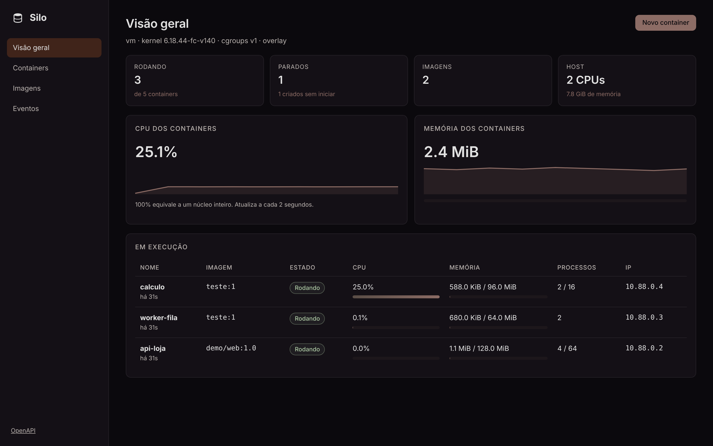
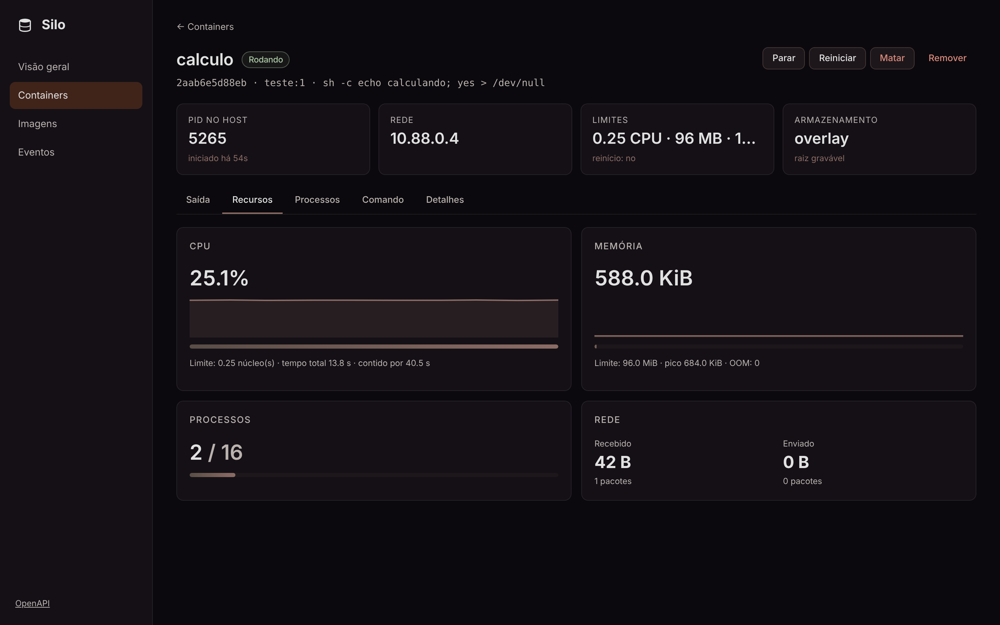
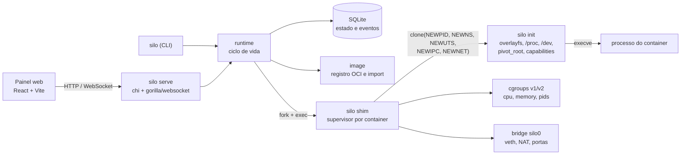
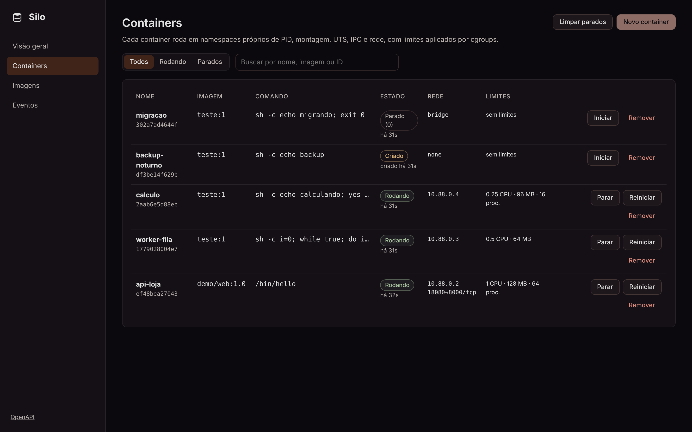
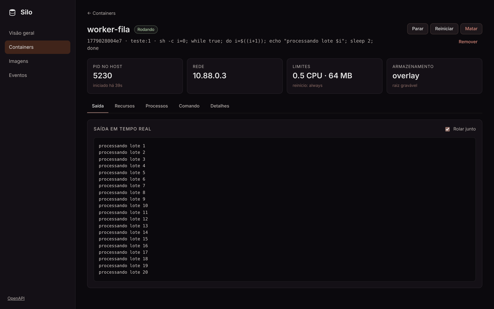
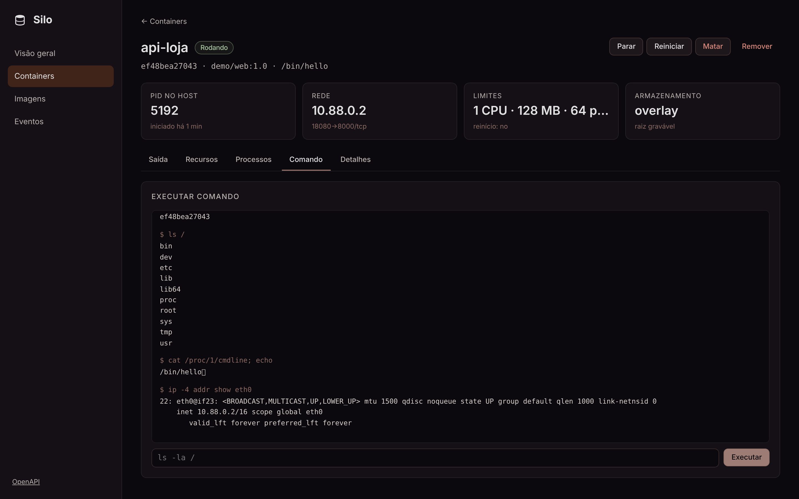
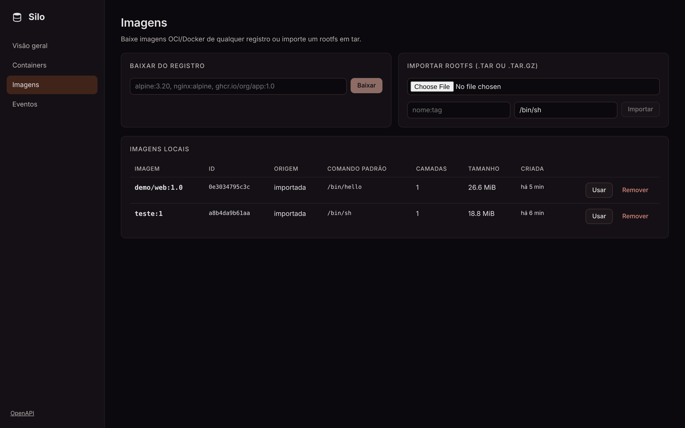
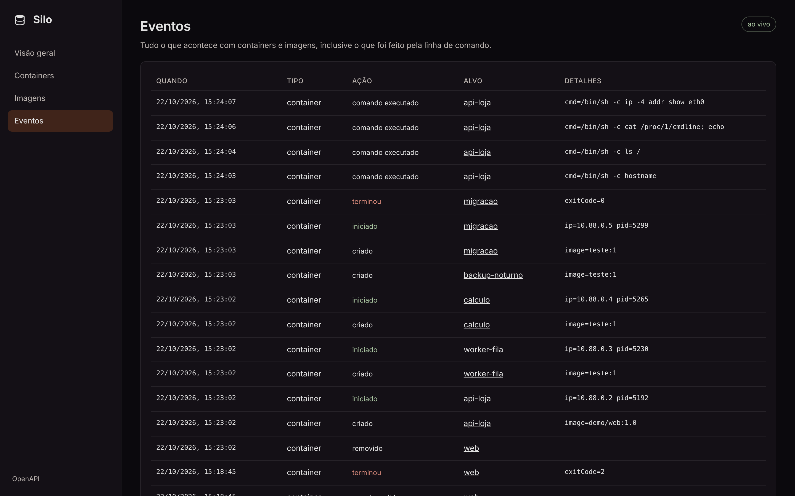

<p align="center">
  
</p>

<h1 align="center">Silo<br><sub><sup><sup><sub>Copyright (©) 2026 Clara Portes</sub></sup></sup></sub></h1>

<p align="center">
  Runtime de containers escrito em Go que usa direto os recursos do kernel Linux: namespaces para isolar processos, rede e sistema de arquivos, cgroups para limitar CPU, memória e processos, e pivot_root com overlayfs para dar a cada container a sua própria raiz.<br>
  Pronto para usar, estudar ou adaptar.
</p>

<p align="center">
  Go 1.24 · Linux namespaces · cgroups v1 e v2 · pivot_root · overlayfs · veth + bridge · chi · WebSocket · SQLite · React 19 + Vite · TypeScript
</p>

---

> **Manual completo:** [`Manual-Silo.pdf`](Manual-Silo.pdf) explica a instalação no Linux e no Windows (WSL2), cada comando da CLI, como o isolamento e os limites funcionam por dentro, a rede, as imagens, cada tela do painel, a API, a configuração, como estender o projeto, os testes e a solução de problemas, passo a passo (cópia em [`docs/`](docs/Manual-Silo.pdf)).

> **Banco de dados:** [`Banco-de-Dados-Silo.pdf`](Banco-de-Dados-Silo.pdf) traz o diagrama de relacionamentos, todas as tabelas com campos, tipos, chaves e índices, a máquina de estados dos containers, as migrações, a organização dos arquivos em disco e como fazer backup.

<p align="center">
  
</p>

## O que o Silo faz

- **Isolamento de verdade:** cada container nasce em namespaces próprios de PID, montagem, UTS, IPC, rede e cgroup. O processo principal é o PID 1 do container e não enxerga nada do host.
- **Raiz própria:** a imagem vira a camada de baixo de um overlayfs e o container escreve só na sua camada de cima. Em seguida o `pivot_root` troca a raiz e a antiga é desmontada (com `chroot` como alternativa quando o `pivot_root` não é possível).
- **Limites com cgroups:** CPU em núcleos (`--cpus 0.5`), peso relativo, memória sem swap (`-m 256m`) e número máximo de processos (`--pids-limit`). Funciona em cgroups v2 e v1, detectados sozinhos.
- **Rede:** modo `bridge` com IP próprio numa bridge `silo0`, par veth, rota padrão e NAT para a internet; modo `none` só com loopback; modo `host` com a rede do servidor. Portas publicadas com `-p 8080:80` (TCP e UDP).
- **Imagens:** baixa imagens OCI e Docker de qualquer registro compatível (Docker Hub, GHCR, registros privados), escolhe a arquitetura certa, confere o digest de cada camada e aplica os whiteouts. Também importa um rootfs em `.tar` ou `.tar.gz`.
- **Ciclo de vida completo:** `run`, `create`, `start`, `stop` (SIGTERM e depois SIGKILL), `restart`, `kill`, `rm`, `exec`, `logs -f`, `stats`, `top`, `inspect`, `events` e `prune`, com políticas de reinício `on-failure` e `always`.
- **Segurança por padrão:** capabilities perigosas removidas, `/proc/kcore`, `/proc/keys` e similares mascarados, `/proc/sys` somente leitura, raiz somente leitura opcional e troca de usuário dentro do container.
- **API e painel:** API REST com WebSocket para saída e eventos em tempo real, OpenAPI, métricas no formato Prometheus e um painel web que mostra e controla tudo.

<p align="center">
  
</p>

## Arquitetura



| Parte | Pasta | Responsabilidade |
|---|---|---|
| CLI | `cmd/silo` | Todos os comandos, inclusive `serve`, e os pontos de entrada internos `shim` e `init` |
| Runtime | `internal/runtime` | Criar, iniciar, parar, supervisionar, executar comandos, saída, estatísticas e processos |
| Init | `internal/runtime/init.go` | Código que roda dentro dos namespaces antes do `execve`: montagens, `pivot_root`, hostname, capabilities e usuário |
| Cgroups | `internal/cgroups` | Limites e estatísticas em cgroups v2 e v1 com a mesma interface |
| Rede | `internal/network` | Bridge, veth, NAT, IPs, DNS e o encaminhamento de portas TCP e UDP |
| Imagens | `internal/image` | Cliente de registro OCI, autenticação por token, camadas, whiteouts e importação |
| Banco | `internal/store` | SQLite com migrações, containers, imagens, portas e eventos |
| API | `internal/api` | Rotas REST, WebSocket, autenticação por token, OpenAPI e métricas |
| Interface | `web/` | Painel em React + TypeScript, compilado para dentro do binário |

### Como um container sobe

1. `silo run` grava o container no banco e, no modo `-d`, inicia um `silo shim` em segundo plano, numa sessão própria.
2. O shim cria o cgroup com os limites e chama o próprio binário como `silo init` com `clone()` em namespaces novos. O init fica parado esperando um sinal num pipe.
3. Com o PID do init em mãos, o shim coloca o processo no cgroup, cria o par veth, move uma ponta para o namespace de rede do container e configura IP, rota e loopback.
4. O shim libera o init, que monta o overlayfs, `/proc`, `/sys`, `/dev`, os volumes e os arquivos de `/etc`, faz o `pivot_root`, define o hostname, remove capabilities e executa o comando da imagem.
5. Se o `execve` falhar, o erro volta pelo pipe e aparece na CLI e no painel. Se der certo, o shim abre as portas publicadas e fica esperando o processo terminar para registrar o código de saída, aplicar a política de reinício e limpar rede e cgroup.

<p align="center">
  
</p>

## Como rodar

O Silo usa recursos do kernel Linux e precisa de **root**.

**Linux (Ubuntu, Debian, Fedora, Arch):**

```bash
sudo apt install -y build-essential iproute2 util-linux iptables   # ou o equivalente da sua distribuição
git clone https://github.com/Violet-pixel/Container-Runtime-Engine.git
cd Container-Runtime-Engine
./scripts/install.sh
```

**Windows:** instale o WSL2 (`wsl --install -d Ubuntu` no PowerShell como administrador), abra o Ubuntu e siga os mesmos passos do Linux. O kernel do WSL2 já tem namespaces, cgroups e overlayfs.

O script compila a interface (se houver Node.js), compila o binário e instala em `/usr/local/bin/silo`. Para instalar também o serviço do systemd com a API e o painel, rode `WITH_SERVICE=1 ./scripts/install.sh`.

### Primeiros passos

```bash
sudo silo pull alpine:3.20
sudo silo run --rm alpine:3.20 sh -c 'hostname; ps; ip addr'
sudo silo run -d --name web -p 8080:80 -m 128m --cpus 0.5 nginx:alpine
curl http://localhost:8080
sudo silo stats web
sudo silo exec -it web sh
sudo silo logs -f web
sudo silo stop web && sudo silo rm web
```

Sem acesso a registros? Gere um rootfs a partir dos binários do próprio host e importe:

```bash
./scripts/mkrootfs.sh base.tar.gz
sudo silo import base.tar.gz base:1 /bin/sh
sudo silo run --rm base:1 sh -c 'echo olá de $(hostname)'
```

### Painel web e API

```bash
sudo silo serve                                  # http://127.0.0.1:7070
sudo silo serve --addr 0.0.0.0:7070 --token um-token-longo   # fora do localhost o token é obrigatório
```

| Endereço | O que é |
|---|---|
| http://127.0.0.1:7070 | Painel: visão geral, containers, imagens e eventos |
| http://127.0.0.1:7070/api/v1 | API REST |
| http://127.0.0.1:7070/api/openapi.yaml | Especificação OpenAPI |
| http://127.0.0.1:7070/api/v1/metrics | Métricas no formato Prometheus |
| http://127.0.0.1:7070/healthz | Saúde do servidor |

<p align="center">
  
  
</p>

## Linha de comando

| Comando | O que faz |
|---|---|
| `silo run [opções] IMAGEM [CMD...]` | Cria e inicia. Sem `-d`, fica ligado ao terminal e repassa o código de saída |
| `silo create` / `silo start [-a]` | Cria sem iniciar e inicia depois |
| `silo stop [-t s]` / `silo restart` / `silo kill [-s SINAL]` | Para com SIGTERM e SIGKILL após o tempo, reinicia ou envia um sinal |
| `silo rm [-f]` / `silo prune` | Remove um container ou todos os parados |
| `silo ps [-a] [-q] [--json]` | Lista containers |
| `silo exec [-e] [-w] [-u] CONTAINER CMD...` | Executa um comando nos namespaces e no cgroup do container |
| `silo logs [-f] [-n N]` | Mostra a saída, opcionalmente em tempo real |
| `silo stats [--no-stream]` / `silo top` | Uso de recursos e processos |
| `silo inspect` | Tudo sobre um container ou imagem em JSON, inclusive caminhos e namespaces |
| `silo pull` / `silo import` / `silo images` / `silo rmi` | Gerenciamento de imagens |
| `silo events [-f]` / `silo info` / `silo serve` | Eventos, informações do host e API com painel |

Opções de `run` e `create`:

| Opção | Exemplo | Efeito |
|---|---|---|
| `--name` | `--name api` | Nome do container |
| `-m` | `-m 256m` | Limite de memória sem swap |
| `--cpus` | `--cpus 1.5` | Limite de CPU em núcleos |
| `--cpu-weight` | `--cpu-weight 500` | Peso relativo de CPU (1 a 10000) |
| `--pids-limit` | `--pids-limit 64` | Máximo de processos |
| `-p` | `-p 127.0.0.1:8080:80/tcp` | Publica uma porta (repetível) |
| `-v` | `-v /srv/dados:/dados:ro` | Monta uma pasta do host (repetível) |
| `-e` | `-e MODO=producao` | Variável de ambiente (repetível) |
| `--network` | `--network none` | `bridge`, `host` ou `none` |
| `--restart` | `--restart on-failure:3` | `no`, `on-failure[:máx]` ou `always` |
| `--read-only` | | Raiz somente leitura |
| `-u`, `-w`, `--hostname`, `--entrypoint`, `--dns` | `-u 1000:1000` | Usuário, diretório, hostname, entrypoint e DNS |
| `--rm` | | Remove ao terminar |
| `--privileged` | | Mantém todas as capabilities |

## API

Todas as rotas ficam em `/api/v1`. Com `--token`, envie `Authorization: Bearer TOKEN` (nos WebSockets, `?token=TOKEN`). Os erros têm sempre o formato `{"error": {"code": "...", "message": "..."}}`.

| Método e rota | O que faz |
|---|---|
| `GET /info` | Kernel, versão dos cgroups, armazenamento, CPUs, memória e contadores |
| `GET /containers` · `POST /containers` | Lista e cria (com `start` e `pull` opcionais) |
| `GET /containers/{id}` · `DELETE /containers/{id}?force=true` | Inspeciona e remove (ID, prefixo do ID ou nome) |
| `POST /containers/{id}/start\|stop\|restart\|kill` | Ciclo de vida |
| `POST /containers/{id}/exec` | Executa um comando curto e devolve a saída |
| `GET /containers/{id}/logs` · `GET /containers/{id}/logs/stream` | Saída e saída em tempo real (WebSocket) |
| `GET /containers/{id}/stats` · `GET /containers/{id}/top` · `GET /stats` | Recursos e processos |
| `GET /images` · `POST /images/pull` · `POST /images/import` · `DELETE /images/{id}` | Imagens (o pull responde em NDJSON com o progresso) |
| `GET /events` · `GET /events/stream` | Histórico e eventos em tempo real (WebSocket) |
| `GET /metrics` | Métricas Prometheus |

```bash
curl -s -X POST http://127.0.0.1:7070/api/v1/containers \
  -H 'Content-Type: application/json' \
  -d '{"name":"api","image":"nginx:alpine","ports":[{"hostPort":8080,"containerPort":80}],"resources":{"cpus":0.5,"memoryMb":128}}'
```

<p align="center">
  
  
</p>

## Configuração

| Variável | Padrão | Uso |
|---|---|---|
| `SILO_ROOT` | `/var/lib/silo` | Banco, imagens, containers e logs |
| `SILO_ADDR` | `127.0.0.1:7070` | Endereço do `silo serve` |
| `SILO_TOKEN` | vazio | Token exigido pela API |
| `SILO_BRIDGE` | `silo0` | Nome da bridge |
| `SILO_BRIDGE_CIDR` | `10.88.0.1/16` | Gateway e sub-rede dos containers |
| `SILO_STORAGE` | `auto` | `overlay`, `copy` ou `auto` (testa o overlayfs) |
| `SILO_STOP_TIMEOUT` | `10` | Segundos entre SIGTERM e SIGKILL |
| `SILO_EVENTS_RETAIN` | `5000` | Quantos eventos guardar |
| `SILO_REGISTRY_USER` / `SILO_REGISTRY_PASSWORD` | vazio | Credenciais de registro privado |
| `SILO_INSECURE_REGISTRIES` | vazio | Registros sem HTTPS, separados por vírgula |
| `SILO_CORS_ORIGIN` | vazio | Origem liberada para uma interface hospedada fora |

Um modelo pronto está em [`deploy/silo.env.example`](deploy/silo.env.example).

## Desenvolvimento

```bash
make build      # binário em bin/silo
make ui         # interface em internal/ui/dist (embutida no binário)
make test       # testes de unidade e da API
make e2e        # testes ponta a ponta como root: isolamento, limites, rede, portas e API
make dev        # interface com recarga automática em http://localhost:5173, apontando para o silo serve
```

### Estrutura

```text
cmd/silo/             CLI e pontos de entrada shim, init e __enter
internal/runtime/     ciclo de vida, supervisor, init do container, exec, logs, stats e top
internal/cgroups/     limites e estatísticas em cgroups v1 e v2
internal/network/     bridge, veth, NAT, IPs, DNS e encaminhamento de portas
internal/image/       cliente de registro OCI, camadas, whiteouts e importação
internal/store/       SQLite, migrações e modelos
internal/api/         rotas REST, WebSocket, OpenAPI e métricas
internal/ui/          interface compilada e servida pelo binário
web/                  código da interface em React + TypeScript
scripts/              instalação e geração de rootfs
deploy/               serviço do systemd e modelo de configuração
test/                 testes ponta a ponta
docs/                 manuais em PDF e imagens do README
```

### Como personalizar

1. **Novo comando da CLI:** adicione uma entrada em `commands` no `cmd/silo/main.go` e escreva a função `cmdX` usando o `runtime.Runtime`.
2. **Nova rota da API:** registre em `Router()` no `internal/api/server.go`, implemente o handler em `handlers.go` e documente no `openapi.yaml`.
3. **Novo limite de cgroup** (por exemplo I/O): acrescente o campo em `store.Resources` e em `cgroups.Limits`, e escreva os arquivos nas funções `Update` das versões v1 e v2.
4. **Novo passo dentro do container:** o `setupContainer` em `internal/runtime/init.go` roda já nos namespaces novos e antes do `execve`. É o lugar para montagens extras, seccomp ou rlimits.
5. **Novo modo de rede:** implemente em `internal/network` e trate no `runOnce` em `internal/runtime/supervise.go`.

O passo a passo de cada caso, com exemplos, está no manual.

### Componentes de terceiros

O Silo depende de componentes com licenças próprias, que continuam valendo para cada um deles:

| Componente | Uso no projeto | Licença |
|---|---|---|
| [chi](https://github.com/go-chi/chi) | Roteador HTTP da API | MIT |
| [gorilla/websocket](https://github.com/gorilla/websocket) | Saída e eventos em tempo real | BSD-2-Clause |
| [go-sqlite3](https://github.com/mattn/go-sqlite3) | Banco de estado (inclui o SQLite, domínio público) | MIT |
| [React](https://react.dev/) e [Vite](https://vite.dev/) | Interface web | MIT |
| [TypeScript](https://www.typescriptlang.org/) | Tipagem da interface | Apache-2.0 |

`ip` (iproute2), `nsenter` (util-linux) e `iptables` são chamados como programas do sistema e não são redistribuídos neste repositório; cada um segue a licença da sua distribuição.

## Licença

Copyright (©) 2026 Clara A. Portes

Este projeto é distribuído sob a licença [MIT](LICENSE). Você pode usar, copiar, modificar e redistribuir o código, inclusive para fins comerciais, desde que mantenha o aviso de copyright e o texto da licença.
